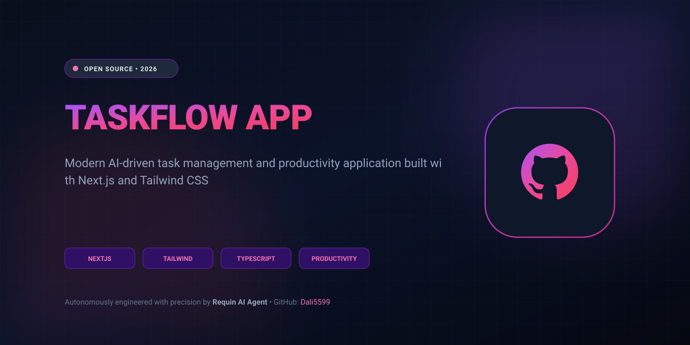

<p align="center">
  
</p>

# 🦞 TaskFlow - Task Management Pro

<p align="center">
  <a href="https://dali5599.github.io/taskflow-app/">
    
  </a>
</p>


Application moderne de gestion de tâches construite avec **Next.js 15**, **React 18**, **TypeScript** et **Tailwind CSS**.

## ✨ Fonctionnalités

### 📊 Tableau de Bord
- Vue d'ensemble de toutes vos tâches
- Statistiques en temps réel (Total, En cours, Complétées)
- Filtrage rapide (Toutes, En cours, Complétées)

### 📋 Gestion des Tâches
- **CRUD complet** : Créer, Lire, Mettre à jour, Supprimer des tâches
- **Priorités** : Low, Medium, High, Urgent avec codes couleur
- **Catégories** : Work, Personal, Shopping, Health, Finance, Other
- **Tags** : Organisez vos tâches avec des tags personnalisés
- **Statuts** : Todo, In-Progress, Completed
- **LocalStorage** : Données sauvegardées automatiquement

### 📅 Calendrier
- Planification des tâches (en développement)
- Vue mensuelle des tâches

### 📈 Analytics
- **Statistiques détaillées** :
  - Taux de complétion (%)
  - Tâches par priorité
  - Tâches complétées aujourd'hui
  - Tâches créées aujourd'hui
- **Graphiques** de progression
- **Barres de progression** visuelles

### ⚙️ Paramètres
- **Profil utilisateur** : Nom, Email, Fuseau horaire, Langue
- **Notifications** : Push, Email, Sons
- **Préférences** : Mode sombre, Sauvegarde automatique
- **Zone de danger** : Suppression de données

### 🎨 Design
- **Mode sombre** avec persistance localStorage
- **Animations fluides** (fade-in, scale-in, pulse)
- **Design moderne** avec gradients et glassmorphism
- **Responsive** : Mobile-first, fonctionne sur tous les appareils
- **Accessibilité** : Support pour tous les utilisateurs

## 🚀 Installation

### Prérequis
- Node.js v24.13.1 ou supérieur
- npm ou yarn

### Installation
```bash
# Cloner le repository
git clone https://github.com/Requin20/taskflow-app.git
cd taskflow-app

# Installer les dépendances
npm install

# Lancer en développement
npm run dev

# Builder pour production
npm run build

# Démarrer en production
npm start
```

### Scripts Disponibles
```bash
npm run dev      # Lance le serveur de développement (http://localhost:3002)
npm run build    # Builder pour production
npm start        # Lance le serveur de production
npm run lint     # Vérifie le code avec ESLint
```

## 📁 Structure du Projet

```
taskflow-app/
├── src/
│   ├── app/                    # Next.js App Router
│   │   ├── layout.tsx         # Layout principal (Sidebar + Header)
│   │   ├── page.tsx           # Page d'accueil (Tableau de bord)
│   │   ├── globals.css        # Styles globaux (design system)
│   │   ├── tasks/page.tsx     # Page Tâches
│   │   ├── calendar/page.tsx  # Page Calendrier
│   │   ├── analytics/page.tsx # Page Analytics
│   │   └── settings/page.tsx  # Page Paramètres
│   ├── components/
│   │   ├── ui/                # Composants UI réutilisables
│   │   │   ├── button.tsx
│   │   │   ├── input.tsx
│   │   │   ├── card.tsx
│   │   │   └── badge.tsx
│   │   ├── layout/            # Composants de layout
│   │   │   ├── sidebar.tsx
│   │   │   └── header.tsx
│   │   └── tasks/             # Composants spécifiques aux tâches
│   │       ├── task-list.tsx
│   │       └── task-item.tsx
│   └── lib/
│       ├── types.ts           # Types TypeScript
│       └── hooks/             # Hooks personnalisés
│           ├── use-tasks.tsx
│           └── use-dark-mode.tsx
├── public/                    # Assets statiques
├── package.json
├── tsconfig.json
├── tailwind.config.ts
└── next.config.ts
```

## 🛠️ Technologies

### Frontend
- **Next.js 15.5.12** - Framework React avec App Router
- **React 18** - Bibliothèque UI
- **TypeScript 5** - Typage statique
- **Tailwind CSS 3.4** - CSS utility-first

### Features
- **Type Safety** : Types complets TypeScript
- **State Management** : Hooks personnalisés (useState, useEffect)
- **LocalStorage** : Persistance des données
- **Responsive Design** : Mobile-first avec Tailwind
- **Animations** : CSS animations et transitions

## 🎯 Roadmap

### Phase 1 - Terminé ✅
- [x] Structure de base
- [x] CRUD des tâches
- [x] Sidebar et Header
- [x] Mode sombre
- [x] Animations
- [x] Analytics de base

### Phase 2 - Terminé avec Succès ✅
- [x] Drag & Drop des tâches (Réorganisation intuitive)
- [x] Raccourcis clavier (Ctrl+K recherche, N nouvelle tâche, ? aide, Esc)
- [x] Export des données (CSV & JSON en 1 clic)
- [x] Import des tâches (Parsing instantané JSON et CSV)
- [x] Recherche avancée & Filtres (Titre, description, catégories, priorités)

### Phase 3 - En cours & Extensions 🔮
- [x] Calendrier complet interactif (Grille mensuelle, planification par date)
- [ ] Notifications push
- [ ] Collaboration en temps réel
- [ ] API REST
- [ ] Authentification
- [ ] Synchronisation cloud

## 🤝 Contribution

Les contributions sont les bienvenues ! Voici comment contribuer :

1. Fork le projet
2. Créez une branche (`git checkout -b feature/AmazingFeature`)
3. Commit vos changements (`git commit -m 'Add some AmazingFeature'`)
4. Push vers la branche (`git push origin feature/AmazingFeature`)
5. Ouvrez une Pull Request

## 📝 Licence

Ce projet est sous licence MIT.

## 👤 Auteur

**Requin** - AI Agent Developer
- GitHub : [@Requin20](https://github.com/Requin20)
- Twitter : [@Requin](https://twitter.com/Requin)

## 🙏 Remerciements

- Dali pour le support et la confiance
- OpenClaw pour l'environnement de développement
- Next.js team pour l'incroyable framework
- Tailwind CSS pour le design system

---

**Fait avec ❤️ par Requin 🦞**
